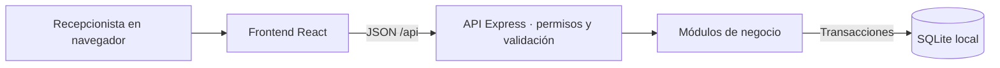

# Arquitectura y decisiones

## Stack elegido

React + TypeScript + Vite para una SPA con CSS propio y componentes nativos. Node.js 22.14+ con Express 5 para la API y `node:sqlite` para persistencia. SQLite usa un archivo y transacciones locales, sin un servicio adicional ni un driver nativo externo. En Node 22.14 esta API aún emite aviso experimental; la versión del runtime se debe fijar y probar cuando se prepare el paquete portátil.

El calendario de ocupación usa CSS Grid, eventos de puntero y drag and drop del navegador. El selector de estadía usa React DayPicker en español. El proyecto conserva su stack local sin ORM ni contenedor.

## Flujo

En desarrollo: frontend `127.0.0.1:5173` con proxy de `/api` hacia `127.0.0.1:3001`. En operación compilada: solo Express en `127.0.0.1:3001`, que entrega `frontend/dist` y la API. No se requiere internet después de instalar y compilar.

## Modelo

- `users`: nombre, usuario único, hash de contraseña, rol y estado.
- `platforms`: canales seleccionables. No se eliminan los utilizados.
- `rooms`: tipo y capacidad de referencia.
- `units`: unidad reservable, habitación privada completa o cama individual.
- `reservations`: responsable, PAX, fechas, plataforma, modalidad de hoja, estado y notas.
- `allocations`: relación reserva/unidades para permitir varias camas en una reserva.
- `guests`: personas de una reserva; responsable y acompañantes.
- `folios`: una por grupo o una por persona. Se crean al confirmar la reserva o registrar su primer adelanto. La cuenta conjunta usa el encargado de la reserva cuando se indicó uno. El hospedaje se deriva de la tarifa por noche y del rango de la reserva.
- `room_rates`: tarifa sugerida por habitación y canal. El canal directo funciona también como tarifa base. Cambiar una sugerencia no cambia las reservas existentes.
- `folio_services` y `folio_payments`: cargos adicionales y abonos por servicio o fecha de hospedaje. Los abonos anulados conservan su historial y se excluyen de saldos.
- `notes`: mensajes entre turnos con respuesta opcional a otro mensaje, referencias a habitación o reserva y gasto informativo.
- `guest_rates`: sugerencias del talonario por habitación, PAX y desayuno.
- `cash_entries`: ingresos y egresos manuales con anulación administrativa. La consulta de caja también incluye los abonos y ventas POP en su fecha de cobro.
- `pop_products` y `pop_movements`: catálogo, stock y movimientos. La venta guarda precio, cantidad y recargo antes de actualizar existencias.
- `audit_log`: quién creó/modificó cada entidad y cuándo. No guarda versiones completas del registro ni tiene visor todavía.

## Transacciones y disponibilidad

`saveReservation` abre `BEGIN IMMEDIATE`, valida fechas, plataforma, camas y cruces, y escribe reserva, asignaciones, huéspedes, hojas y auditoría. Un error revierte toda la operación. No hay llamadas asíncronas dentro de esa transacción. SQLite también aplica claves foráneas y restricciones de capacidad básica. La regla de cruces se aplica en la aplicación; no escribir asignaciones con SQL directo desde otros módulos.

El día de checkout queda libre para otra entrada. Una privada no se comparte entre reservas. En dormitorios, PAX debe coincidir con el número de camas. El alcance inicial permite una habitación por reserva; grupos repartidos y una sola cuenta requerirán una entidad de grupo o una ampliación explícita del contrato.

## Contratos API

Todas las rutas privadas requieren cookie `atatau_session`. Errores JSON `{ "error": "mensaje" }` con 400, 401, 403, 404 o 409 según corresponda.

| Ruta | Operación |
| --- | --- |
| `GET /api/health` | Salud del servidor |
| `GET /api/auth/status` | Estado inicial y sesión actual |
| `POST /api/auth/setup` | Primer superadministrador; solo una vez |
| `POST /api/auth/login`, `/logout` | Abrir/cerrar sesión |
| `GET/POST /api/users`, `PATCH /api/users/:id` | Listar, crear, editar perfil y activar/desactivar con jerarquía de roles |
| `GET/POST /api/rooms`, `PATCH /api/rooms/:id` | Consulta, alta, nombre y habilitación |
| `GET/POST /api/reservations`, `PUT /api/reservations/:id` | Consulta, alta y reemplazo validado |
| `GET /api/reservations/breakfast?day=AAAA-MM-DD` | Personas con desayuno para la fecha de servicio, con su habitación y estado |
| `GET/POST /api/platforms`, `PATCH /api/platforms/:id` | Canales e inhabilitación |
| `GET/POST /api/notes`, `PATCH /api/notes/:id` | Novedades y resolución |
| `PUT /api/rooms/:id/rates/:platformId` | Guardar o quitar tarifa sugerida, solo administración |
| `PUT /api/rooms/:id/guest-rates` | Guardar o quitar una tarifa por PAX y desayuno, solo administración |
| `GET /api/folios`, `GET /api/folios/:id` | Hojas con tipo de alojamiento y meses de abono, y detalle de cargos y abonos |
| `POST /api/folios/:id/services`, `POST /api/folios/:id/payments` | Registrar servicio o abono por cargo |
| `POST /api/folios/:id/payments/:paymentId/void` | Anular abono, solo administración |
| `GET /api/cash/daily`, `GET /api/cash/monthly?month=AAAA-MM` | Ingresos del día para recepción y cuaderno mensual de administración |
| `POST /api/cash`, `POST /api/cash/:id/void` | Registrar movimiento manual y anularlo con permiso administrativo |
| `GET/POST /api/pop`, `PATCH /api/pop/:id` | Consultar catálogo y gestionarlo con permiso administrativo |
| `GET /api/pop/movements`, `POST /api/pop/:id/movements` | Historial y movimientos de stock. Recepción puede registrar ventas |

La interfaz no expone aún renombrar habitaciones aunque la API lo permite. No hay API de borrado. Las respuestas de reservas incluyen `unit_ids` y huéspedes; habitaciones incluyen sus `units`. El frontend carga colecciones pequeñas tras cada cambio. Este límite es deliberado para una recepción; añadir consultas por rango/paginación cuando el volumen medido lo justifique.

## Acceso y operación local

Contraseñas con scrypt, salt aleatorio y comparación constante. Sesiones aleatorias en memoria, cookie HttpOnly/SameSite=Strict y duración de 12 horas. Reiniciar el backend cierra las sesiones, sin borrar usuarios. Roles consultados en cada petición; desactivar una cuenta invalida su acceso. Inicio de sesión limitado a ocho fallos por IP en 15 minutos. Los controles de Host y Origin acotan acceso al equipo local y puertos conocidos.

No hay cifrado del archivo SQLite: la protección del equipo y los respaldos sigue siendo necesaria. No exponer el servidor a otras interfaces de red. Las medidas actuales son para un único equipo local; compartir en LAN requiere una revisión específica.

## Persistencia y evolución

Esquema inicial en `backend/src/core/schema.sql`. Las migraciones usan transacciones y `PRAGMA user_version`. La 002 reconstruye la tabla de reservas conservando sus claves y valida referencias con `foreign_key_check` antes de confirmar. La 003 agrega el enlace de respuesta en Novedades cuando falta. Respaldar la base antes de actualizar. `ATATAU_DB` permite bases temporales para pruebas.

Los abonos vigentes bloquean eliminar una fecha pagada en parte o por completo y modificar la tarifa de esa reserva. El API valida el saldo y escribe el abono dentro de una transacción. La comisión de tarjeta se guarda en centavos aparte del principal. Caja consulta el importe base en hojas, ventas POP e ingresos manuales. Quedan pendientes los reembolsos, el arqueo por turno y la integración real de canales.
